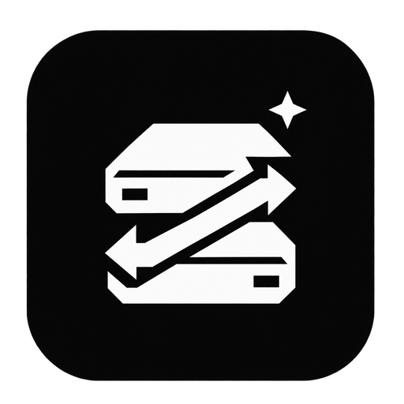
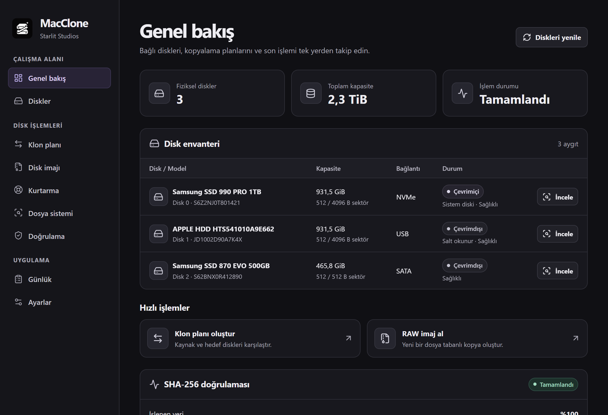
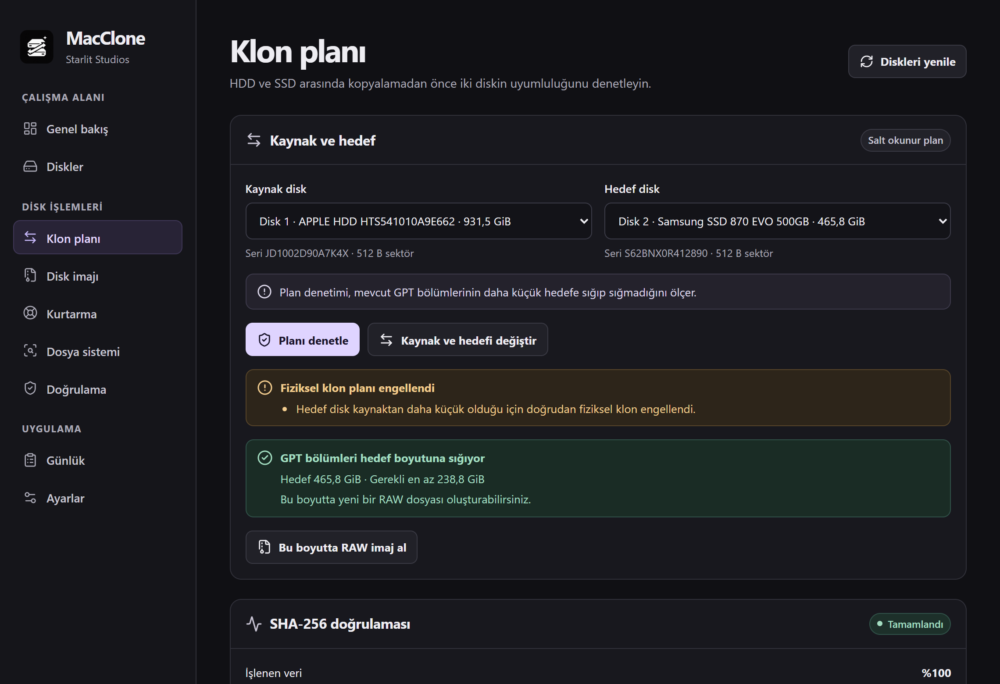
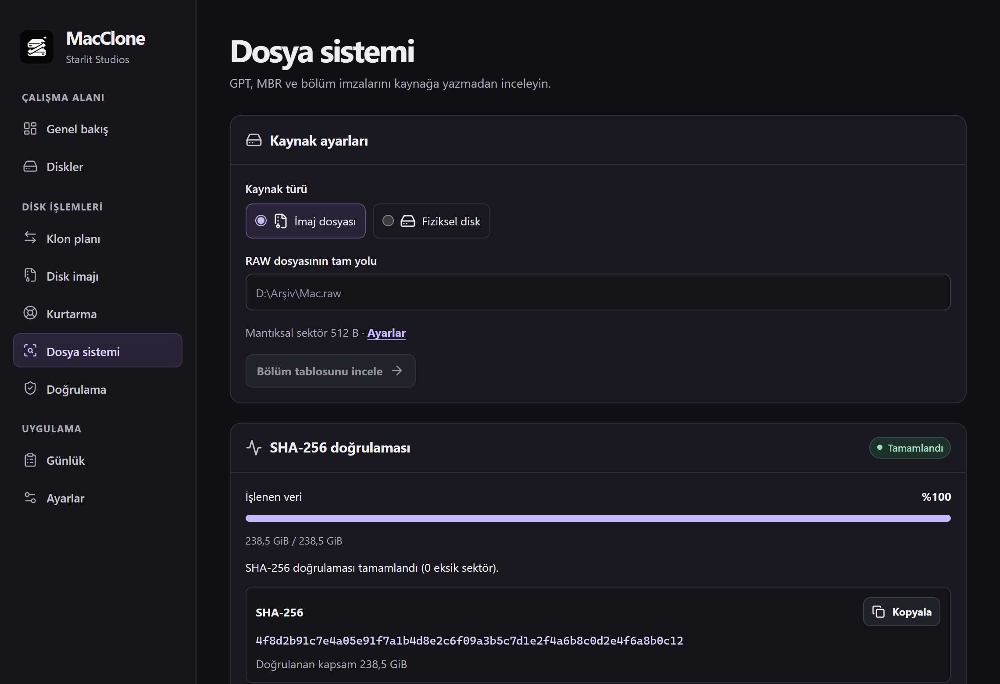

<div align="center">
  
  <h1>MacClone</h1>
  <p><strong>macOS disk cloning, RAW imaging, APFS container inspection &amp; SHA-256 verification tool for Windows.</strong></p>
  <p><em>Developed by Starlit Studios</em></p>

  <p>
    <a href="https://github.com/hfatih/macclone/releases/latest">
      
    </a>
    <a href="#screenshots">
      
    </a>
    <a href="#cloning-compatibility">
      
    </a>
    <a href="#building--running-on-windows">
      
    </a>
    <a href="README.tr.md">
      
    </a>
  </p>

  <p>
    <a href="https://github.com/hfatih/macclone/releases/latest">
      
    </a>
    <a href="https://github.com/hfatih/macclone/releases">
      
    </a>
    <a href="https://github.com/hfatih/macclone/actions/workflows/ci.yml">
      
    </a>
    
    
    <a href="LICENSE">
      
    </a>
    
  </p>
</div>

---

MacClone is designed to work in both directions between HDDs and SSDs. The Windows desktop application inspects macOS disks, validates clone plans, browses APFS volumes, and creates verified RAW disk images. Direct physical disk writing remains gated behind an opt-in development CLI feature until full Windows acceptance is complete.

---

## Download (Windows 10/11 x64)

Grab the prebuilt Windows installer and standalone CLI binary from the [Latest Release](https://github.com/hfatih/macclone/releases/latest):

| Asset | Description |
| :--- | :--- |
| **`MacClone_0.1.5_x64-setup.exe`** | Windows 10/11 x64 desktop installer (NSIS · embedded UAC administrator manifest) |
| **`macclone.exe`** | Portable single-binary Windows x64 CLI |
| **`SHA256SUMS.txt`** | Cryptographic checksums for release integrity verification |

> [!NOTE]
> The installer is currently unsigned. If Windows SmartScreen appears, click **More info → Run anyway** to continue.

---

## Important: Cloning APFS to a Smaller SSD (Capacity Difference)

> [!WARNING]
> When cloning a macOS installation from a larger drive (e.g. a **320 GB / 298 GiB HDD**) onto a smaller SSD (e.g. **240 GB / 238 GiB**) as a bootable disk, Windows **cannot** shrink the APFS container directly — even if used data is small (e.g. 20 GB) — if the APFS container itself spans 297 GiB.

- **Why?** APFS (Copy-on-Write B-tree) distributes blocks across the entire container; safe block relocation and shrinking (`apfs.kext`) is proprietary to macOS. Force-truncating at 238 GiB from Windows corrupts macOS.
- **Solution for a bootable clone (30 seconds):** Connect the source disk to a Mac and shrink the APFS container below the target SSD capacity in Terminal:
  ```bash
  diskutil list
  diskutil apfs resizeContainer diskXs2 220g
  ```
  Reconnect the disk to Windows in MacClone and the GPT fit check will pass.
- **For file/data recovery only (`v0.1.5+`):** Open **Disks → Inspect → Open Container** (powered by the Apache-2.0 [`SecurityRonin/apfs-forensic`](https://github.com/SecurityRonin/apfs-forensic) `apfs-core` engine) to browse APFS volumes (`Macintosh HD`, `Data`, `Preboot`, `Recovery`, `VM`) and copy any folders or files directly to Windows.

---

## Screenshots

<p align="center">
  
</p>

<details>
  <summary>View Clone Plan &amp; Inspection / Verification Screens</summary>
  <p align="center">
    
  </p>
  <p align="center">
    
  </p>
</details>

---

## Cloning Compatibility

| Source &amp; Target Scenario | Behavior |
| :--- | :--- |
| **HDD → SSD or SSD → HDD**, equal capacity &amp; logical sector size | Full byte-for-byte disk copy including EFI, GPT, APFS/HFS+, and unallocated space. |
| **Smaller source → larger target**, equal logical sector size | Uses `--relocate-gpt` for valid GPTs. Updates Protective MBR and GPT headers, relocates backup GPT to the final LBA, preserves partition GUIDs/boundaries/contents, and leaves trailing space unallocated. |
| **Larger source → smaller target**, existing GPT partitions fit | Desktop and CLI can produce a standalone target-sized RAW image. Direct physical clone plan is blocked. |
| **Mismatched logical sector size** or partitions exceed target | Cloning and target-sized imaging are blocked. |
| **Larger target** with damaged or hybrid GPT on source | GPT relocation is rejected. A source-sized RAW image can still be captured. |

SHA-256 verification re-reads the completed target from disk. For equal capacities, it matches the source stream directly. For larger targets, the expected digest accounts for the relocated GPT and zero-filled trailing region. Actual macOS booting from the cloned drive is verified separately.

---

## Supported Workflows Today

| Workflow | Details |
| :--- | :--- |
| **Inventory &amp; Dry-Run** | Queries Windows Storage for model, serial, unique ID, bus, capacity, logical/physical sector size, boot/system/online state, and health summary. Preserves unknown fields. Physical clone plans report same-device, capacity, and geometry issues. |
| **Disk &amp; FS Inspection** | Validates CRC32 on both GPT headers and partition arrays, EFI GUID, MBR entries, partition bounds/overlaps, APM signature, APFS `NXSB`, and HFS+/HFSX signatures. Reports if one GPT copy is damaged. Includes APFS volume browsing (`v0.1.5+`). |
| **RAW Imaging** | Copies byte `0` through the final byte into a fresh user-selected job directory. Supports standalone image files or pre-offlined, identity-verified physical disks on Windows. |
| **Resume &amp; Recovery** | Flushes chunk logs with metadata and data checksums after every write. Handles cancellation, partial trailing entries, and resume. `--recover` drops to sector-level reads (2 retries) on definite media errors and logs missing sectors in an explicit map; general I/O or disconnect errors halt the job safely. |
| **SHA-256 Verification** | Re-reads the full output image and compares SHA-256 against the source stream captured during imaging. Exit codes: `0` (verified), `2` (`partial` with missing-sector padding), `1` (failure). |
| **Desktop App** | Tauri + Vue GUI with disk inventory, clone planner, imaging/recovery start &amp; resume, APFS/GPT inspection, SHA-256 verification, live progress, and cancellation. Session logs stay separate from persistent job journals. |

---

## Physical HDD &amp; SSD Cloning

Enabling the `windows-physical-clone` Cargo feature adds the interactive `clone SOURCE_NUMBER TARGET_NUMBER JOB_DIR [--resume] [--relocate-gpt]` command to the Windows CLI. The default release build provides imaging and read-only planning.

- Matching logical sector sizes are required in both directions.
- Larger targets require `--relocate-gpt` (zeroes trailing space without resizing filesystems).
- Both source and target must be offline and free of mounted Windows volumes.
- The job directory must reside on a separate direct physical disk (not source, target, virtual, or ambiguous storage).
- To resume an interrupted clone, keep the same source, target, job directory, and flags; if Windows reassigns disk numbers after reconnect, pass the updated number — MacClone re-verifies stable hardware IDs and completed blocks.

For Windows acceptance testing, validate the transport layer first inside an isolated elevated Windows x64 VM against a disposable VHDX:

```powershell
cargo test --locked -p mc-device --features windows-physical-clone disposable_vhdx_raw_roundtrip -- --ignored --nocapture
cargo build --locked -p macclone --features windows-physical-clone
.\target\debug\macclone.exe --help
```

### Target-Sized RAW Images for Smaller SSDs

Even if a 320 GB disk holds only 100 GB of files, its APFS partition may still span to the end of the disk. MacClone checks GPT partition boundaries and backup GPT space rather than file occupancy. If existing partitions already fit the smaller target, the generated RAW image trims trailing unallocated space, updates the Protective MBR, and relocates the backup GPT while leaving APFS/HFS+ partitions intact.

- **Desktop:** Select the offline source and smaller SSD in **Clone Plan → Check Plan**. When it fits, click **Create RAW Image at Target Size** (the SSD is used strictly as a size reference).
- **CLI:**
  ```powershell
  macclone.exe dry-run SOURCE.raw --target-bytes 256000000000
  macclone.exe image SOURCE.raw NEW_JOB_DIR --target-bytes 256000000000
  ```
  Replace the byte count with the target SSD's exact inventory capacity. Add `--sector 4096` for 4Kn RAW sources.

If existing partitions do not fit, resize them on macOS with [Apple Disk Utility](https://support.apple.com/en-bn/guide/disk-utility/dskutl14027/mac) or transfer user data with [Apple Migration Assistant](https://support.apple.com/guide/mac-help/transfer-information-mac-computer-device-mh27921/mac).

---

## Building &amp; Running on Windows

**Prerequisites:** Windows 10/11 x64, Visual Studio Build Tools 2022 (**Desktop development with C++** + Windows SDK), Rust stable MSVC (tested with `1.94.1`), Node.js 24 LTS / npm, and Microsoft Edge WebView2 Evergreen Runtime.

```powershell
rustup default stable-x86_64-pc-windows-msvc
rustup component add rustfmt clippy
cargo test --locked
cargo build --locked --release -p macclone
.\target\release\macclone.exe --help

cd apps\desktop
npm ci
npm run lint
npm run build
npm run tauri -- dev
```

Build the production NSIS installer from `apps\desktop`:

```powershell
npm run tauri -- build --bundles nsis -- --locked
Get-ChildItem ..\..\target\release\bundle\nsis\*.exe
```

> [!TIP]
> On Linux, file-based workflows work out of the box via `cargo test --locked` and `cargo run -p macclone -- --help`. Physical disk inventory is Windows-specific.

---

## Quick Start (No Physical Disk Required)

Generate a deterministic 2 MiB synthetic disk image with two partitions and a backup GPT using Python 3:

```powershell
python scripts/make_fixture.py example.raw
cargo run --locked -p macclone -- inspect example.raw
cargo run --locked -p macclone -- dry-run example.raw
cargo run --locked -p macclone -- image example.raw example-job
$report = Get-Content example-job/report.json -Raw | ConvertFrom-Json
cargo run --locked -p macclone -- verify example-job/image.raw $report.sha256
```

To inspect real Windows disks, run `macclone.exe list` and pass a specific device as a single PowerShell argument in `disk:NUMBER:UNIQUE_ID` format. Run only the CLI from an elevated PowerShell when raw read access is required. MacClone never invokes `mount`, `dismount`, `diskpart`, or `format`, and aborts immediately if the opened handle cannot confirm the source's serial/ID and geometry.

---

## Job Journals, Verification &amp; Troubleshooting

<details>
  <summary>Job Files &amp; Resume Semantics</summary>

- **`job.json`** — Stores the job schema, source identity/geometry, transfer parameters, and target file identifiers while holding an OS file lock for the duration of the job.
- **`image.raw` &amp; `map.jsonl`** — Each complete line in `map.jsonl` records a byte range, SHA-256 digest, missing sector indices, and a metadata summary.
- **`report.json`** — Published only after the finished target is re-read. `target_reread_bytes` covers total target length including padding; `verified_bytes` reflects readable source coverage.
- **`--resume`** — Requires matching source, job folder, sector size, block size, and recovery flag (e.g. `image source.raw rescue-job --recover --block 1048576`). Previously logged bad sectors are not stressed again.
- **Sector size** — File-based inspection defaults to `512 B`; pass `--sector 4096` for 4Kn images. Physical devices use their reported geometry.

</details>

<details>
  <summary>Validation Suite &amp; Common Issues</summary>

```powershell
cargo fmt --all -- --check
cargo clippy --locked --all-targets -- -D warnings
cargo test --locked
cargo build --locked -p macclone
python scripts/smoke.py target/debug/macclone.exe
```

- **Access denied / sharing violation** — Verify elevated privileges and source disk state. MacClone never weakens write-sharing or read-only protections.
- **Identity/serial or checkpoint mismatch** — The disk number may have been reassigned, the file altered, or the USB bridge may not expose a stable unique ID. Hand-editing `map.jsonl` invalidates prior proof.
- **Disk full or cable disconnected** — Free space, reconnect the identical source, and restart with `--resume`. If initial files were not yet created, choose a new job directory.
- **Failing source media** — `--recover` logs definite media errors, but does not implement `ddrescue`'s multi-pass trim/scrape scheduler.
- **UI closed mid-job** — Reopen the app and resume using the same job directory. No persistent background Windows service is installed.
- **Valid GPT, Mac won't boot** — FileVault keys, SSV, and Mac Startup Security policies are evaluated separately; MacClone does not perform live boot testing.

</details>

---

## Contributing &amp; Repository Layout

GitHub Actions runs Linux and Windows core tests, pinned `partition-manager` cross-checks, and Windows NSIS packaging. Please use synthetic fixture images when submitting contributions.

[Contributing Guide](CONTRIBUTING.md) · [Architecture](docs/ARCHITECTURE.md) · [Validation Scope](docs/VALIDATION.md) · [GitLab Plan](docs/GITLAB-PLAN.md) · [GNU GPL v3.0](LICENSE)

```text
macclone/
├── apps/
│   ├── cli/                       # Rust CLI binary
│   └── desktop/{src,src-tauri}/   # Vue UI, typed Tauri IPC & local job runner
├── crates/
│   ├── mc-device/                 # Device identity, Win32 raw reader, clone planning rules
│   ├── mc-engine/                 # Imaging, recovery, journaling, resume & SHA-256 verification
│   └── mc-inspect/                # Read-only partition, GPT & APFS/HFS+ inspection
├── docs/                          # RESEARCH, ARCHITECTURE, DEPENDENCIES, LICENSE_AUDIT, VALIDATION
├── scripts/                       # Deterministic fixture builder & end-to-end CLI smoke tests
├── tests/fixtures/                # Synthetic test disk specifications
└── .github/workflows/ci.yml       # Linux/Windows CI & Windows NSIS packaging
```

> **Open Scope:** Full Windows acceptance for physical cloning, restoring RAW images to SSDs, privileged write helper, detailed SMART telemetry, APFS volume group/snapshot/Preboot &amp; Recovery analysis, FileVault unlocking, HFS+ catalog/journal inspection, and real-hardware Mac boot verification. See [`docs/VALIDATION.md`](docs/VALIDATION.md) for current verification coverage.

## License

Project-owned code and original material in this revision are licensed under [GNU GPL v3.0](LICENSE) (GPL-3.0-only). Third-party code, fonts, imagery, data, and brand assets retain their own terms and attributions. [Previous license and copyright notice](licenses/previous-license.txt).
