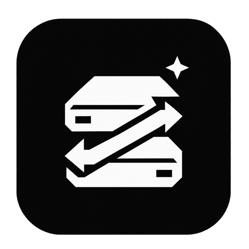
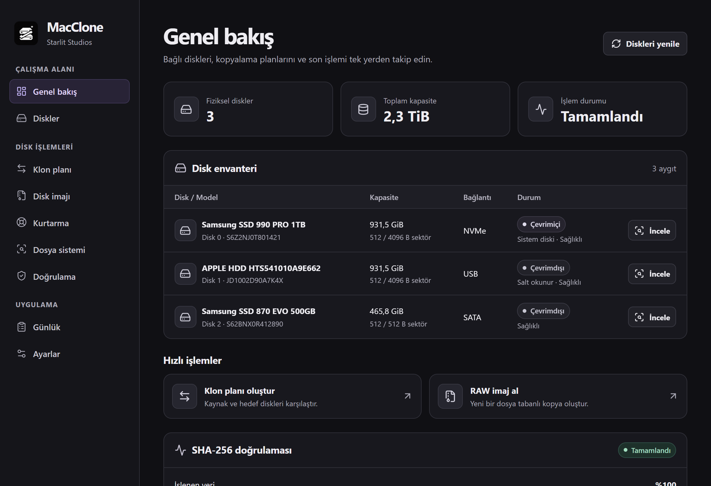
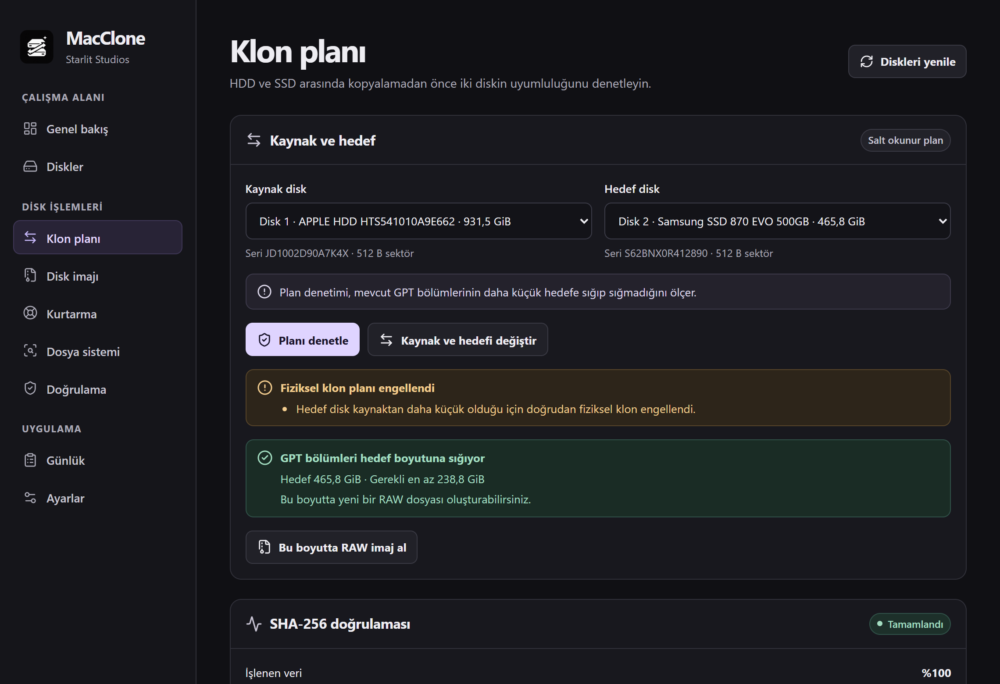
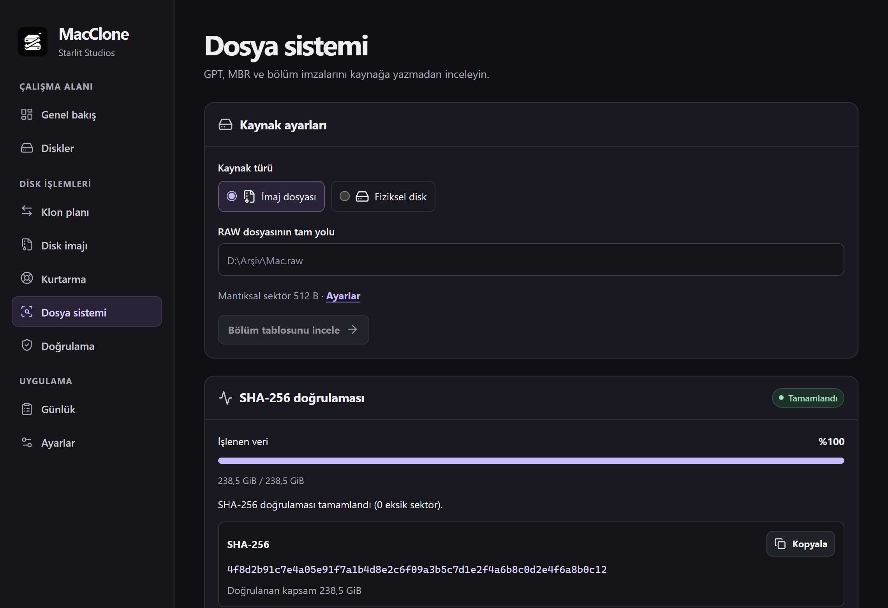

<div align="center">
  
  <h1>MacClone</h1>
  <p><strong>Windows için macOS disk klonlama, RAW imaj, APFS konteyner inceleme ve SHA-256 doğrulama aracı.</strong></p>
  <p><em>Starlit Studios tarafından geliştirilmiştir.</em></p>

  <p>
    <a href="https://github.com/hfatih/macclone/releases/latest">
      
    </a>
    <a href="#ekran-görüntüleri">
      
    </a>
    <a href="#klonlama-uyumluluğu">
      
    </a>
    <a href="#windowsta-derleme-ve-başlatma">
      
    </a>
    <a href="README.md">
      
    </a>
  </p>

  <p>
    <a href="https://github.com/hfatih/macclone/releases/latest">
      
    </a>
    <a href="https://github.com/hfatih/macclone/releases">
      
    </a>
    <a href="https://github.com/hfatih/macclone/actions/workflows/ci.yml">
      
    </a>
    
    
    <a href="LICENSE">
      
    </a>
    
  </p>
</div>

---

MacClone, HDD ve SSD arasında her iki yönde çalışacak şekilde tasarlandı. Windows masaüstü sürümü diskleri inceler, klon planını denetler, APFS hacimlerini gezer ve RAW imaj çıkarır. Fiziksel yazma, Windows kabulü tamamlanana kadar isteğe bağlı geliştirme CLI'sindedir.

## İndirme (Windows 10/11 x64)

Hazır Windows kurulum dosyasını ve tek dosya CLI aracını [Son Sürüm (Releases)](https://github.com/hfatih/macclone/releases/latest) sayfasından indirebilirsiniz:

| Dosya | Açıklama |
| :--- | :--- |
| **`MacClone_0.1.5_x64-setup.exe`** | Windows 10/11 x64 masaüstü kurulum yükleyicisi (NSIS · otomatik UAC yönetici manifestli) |
| **`macclone.exe`** | Taşınabilir Windows x64 CLI aracı |
| **`SHA256SUMS.txt`** | Dosya bütünlüğü doğrulama özetleri |

> [!NOTE]
> Kurulum dosyası kod imzalı değildir; Windows SmartScreen uyarısı çıkarsa **Ek bilgi → Yine de çalıştır** seçeneğiyle devam edebilirsiniz.

## Önemli Not: Daha Küçük SSD'ye APFS Kopyalama (GB Farkı)

> [!WARNING]
> Örneğin **320 GB (298 GiB) HDD** üzerindeki bir macOS kurulumunu **240 GB (238 GiB) SSD**'ye açılabilir (bootable) olarak klonlamak istediğinizde, içerideki veri az olsa bile (ör. 20 GB) **APFS konteyneri 297 GiB** olarak tanımlıysa Windows üzerinden doğrudan küçültme yapılamaz.

- **Neden?** APFS (Copy-on-Write B-tree) blokları konteynerin tamamına dağıtır; güvenli blok taşıma/küçültme sürücüsü (`apfs.kext`) Apple tarafından yalnızca macOS'e özel tutulur. Windows'tan zorla 238 GiB'den kesmek macOS'i bozar.
- **Bootable klon için çözüm (30 saniye):** Kaynak diski Mac'e takıp Terminal'de APFS konteynerini hedef SSD'den küçük bir boyuta çekin:
  ```bash
  diskutil list
  diskutil apfs resizeContainer diskXs2 220g
  ```
  Sonrasında Windows'ta MacClone'a geri taktığınızda GPT denetimi geçer.
- **Sadece verileri/dosyaları kurtarmak için (v0.1.5+):** **Diskler → İncele → Konteyneri aç** ile (Apache-2.0 lisanslı [`SecurityRonin/apfs-forensic`](https://github.com/SecurityRonin/apfs-forensic) `apfs-core` motoru) APFS hacimlerinin (`Macintosh HD`, `Data`, `Preboot`, `Recovery`, `VM`) içini gezebilir ve istediğiniz klasör/dosyaları doğrudan Windows'a kopyalayabilirsiniz.

## Ekran görüntüleri

<p align="center">
  
</p>

<details>
  <summary>Klon planı ve doğrulama ekranları</summary>
  <p align="center">
    
  </p>
  <p align="center">
    
  </p>
</details>

## Klonlama uyumluluğu

| Kaynak ve hedef | Sonuç |
|---|---|
| HDD → SSD veya SSD → HDD, eşit kapasite ve aynı mantıksal sektör boyu | EFI, GPT, APFS/HFS+ ve ayrılmamış alanlar dahil tam disk, bayt bayt kopyalanır. |
| Kaynak daha küçük, hedef daha büyük, mantıksal sektör boyu eşit | Sağlam GPT için `--relocate-gpt` kullanılır. Koruyucu MBR ve GPT başlıkları güncellenir, yedek tablo son LBA'ya taşınır. Bölüm GUID'leri, sınırları ve içerikleri korunur. Ek alan boş kalır. |
| Hedef daha küçük, mevcut GPT bölümleri hedefe sığıyor | Masaüstü ve CLI, hedef boyutunda bağımsız bir RAW imaj oluşturabilir. Fiziksel klon planı engellenir. |
| Mantıksal sektör boyu farklı veya mevcut bölümler hedefe sığmıyor | İlgili klon veya hedef boyutu için imaj işlemi engellenir. |
| Büyük hedef, kaynakta hasarlı ya da hibrit GPT | GPT taşıma işlemi reddedilir. Kaynağın kendi boyutunda RAW imaj alınabilir. |

SHA-256, hedefin yeniden okunan içeriğini doğrular. Eşit kapasitede karşılaştırma doğrudan kaynakla yapılır. Büyük hedefte beklenen sonuç, taşınan GPT ve sıfırlanan ek alanla birlikte doğrulanır. macOS'un klondan açılması ayrıca sınanır.

## Bugün çalışan akışlar

| İş | Davranış |
|---|---|
| Envanter ve dry-run | Windows Storage sağlayıcısından model, seri, kimlik, bus, kapasite, mantıksal/fiziksel sektör, boot/system/online ve sağlık özeti. Bilinmeyen değer korunur. Fiziksel klon planı aynı aygıt, kapasite ve geometri sorunlarını raporlar. |
| İnceleme | GPT başlığı ve bölüm dizisinin iki kopyasının CRC32'si, EFI GUID, temel MBR kayıtları, bölüm sınırları/çakışmalar, APM imzası, APFS NXSB, HFS+/HFSX imzası. Bir GPT kopyası bozuksa diğeri raporda belirtilir. |
| RAW imaj | Kullanıcının yeni belirlediği klasöre kaynağın ilk baytından son baytına kadar kopyalar. Bağımsız bir imaj dosyası veya Windows'ta önceden çevrimdışına alınmış, doğrulanabilen fiziksel kaynak kullanılabilir. |
| Kesinti ve kurtarma | Hedef flush sonrasında parça günlüğü, metadata ve veri checksum'ları. İptal, yarım son kayıt ve yeniden başlama. Recovery modunda kesin medya hatasında sektör bazına inip iki deneme yapar. Eksik sektörü açık haritaya kaydeder. Genel I/O veya bağlantı hatası işi durdurur. |
| Doğrulama | İmajın tamamı yeniden okunur. İlk okumada elde edilen kaynak akışıyla SHA-256 karşılaştırılır. Eksik dolgulu işin sonucu `partial`; CLI çıkış kodu 2. Tam doğrulama kodu 0, başarısız işlem kodu 1. |
| Masaüstü | Türkçe arayüzden disk listesi, disk klon planı, imaj/kurtarma başlatma ve devam, inceleme, doğrulama, ilerleme ve iptal. Oturum günlüğü ile kalıcı iş kayıtları ayrıdır. |

## Fiziksel HDD ve SSD klonu

`windows-physical-clone` Cargo özelliği Windows CLI'ye etkileşimli `clone SOURCE_NUMBER TARGET_NUMBER JOB_DIR [--resume] [--relocate-gpt]` komutunu ekler. Varsayılan uygulama sürümü imaj ve salt okunur plan sunar. Eşit mantıksal sektör boyu her iki yönde de gerekir. Büyük hedef için ayrıca `--relocate-gpt` kullanılır. Bu işlem hedefin ek alanını sıfırlar ve dosya sistemini büyütmez. Kaynak ve hedef çevrimdışı ve bağlı Windows volume'larından ayrı olmalıdır. Günlük dizininin depolama alanı, kaynak ve hedef dışındaki doğrudan fiziksel disklere bağlanabilmelidir. Sanal veya belirsiz depolama hata olarak gösterilir. Aynı iş dizininden devam etmek için kaynağı, hedefi ve ayarları koruyun. Windows yeniden bağlanan diske yeni numara verirse güncel numarayı girin. Uygulama sabit kimlikleri ve kopyalanmış blokları yeniden denetler.

Windows kabulü için önce izole, yükseltilmiş Windows x64 VM içinde yalnızca testin oluşturduğu VHDX üzerinde aktarım katmanını doğrulayın.

```powershell
cargo test --locked -p mc-device --features windows-physical-clone disposable_vhdx_raw_roundtrip -- --ignored --nocapture
cargo build --locked -p macclone --features windows-physical-clone
.\target\debug\macclone.exe --help
```

### Daha küçük hedef için RAW imaj

Örneğin 320 GB diskte 100 GB dosya bulunabilir ve APFS bölümü yine de diskin sonuna kadar uzanabilir. MacClone, dosya doluluğu yerine GPT'deki bölüm sınırlarını ve yedek tablonun kaplayacağı alanı denetler. Bölümler zaten sığıyorsa yeni imaj ayrılmamış son alanı dışarıda bırakır, koruyucu MBR'yi günceller ve yedek GPT'yi yeni son sektöre taşır. APFS ve HFS+ bölümleri mevcut boyutlarını korur.

Windows masaüstünde, çevrimdışı kaynak ile küçük SSD'yi **Klon planı** ekranında seçip **Planı denetle**'ye basın. Sığıyorsa **Bu boyutta RAW imaj al** düğmesi SSD'nin envanterden okunan kapasitesini kullanarak imaj ekranını açar. Çıktı seçtiğiniz iş klasöründe oluşur. SSD yalnızca boyut referansı olarak kullanılır.

CLI üzerinden bir RAW dosyasını denetlemek ve dönüştürmek için şu komutları kullanın.

```powershell
macclone.exe dry-run SOURCE.raw --target-bytes 256000000000
macclone.exe image SOURCE.raw NEW_JOB_DIR --target-bytes 256000000000
```

Örnek bayt değerini SSD'nin envanterden okunan gerçek kapasitesiyle değiştirin. `dry-run`, geçerli GPT için mevcut bölüm yerleşiminin gerektirdiği minimum kapasiteyi bildirir ve hiçbir şey yazmaz. `image` çıktısı yeni klasördeki `image.raw` dosyasıdır. 4096 bayt mantıksal sektörlü RAW kaynak için her iki komuta `--sector 4096` ekleyin. Aynı komutlar daha büyük bir GPT imajı için de kullanılabilir.

Mevcut bölümler sığmıyorsa, macOS'ta desteklenen yerleşimlerde bölüm boyutunu Disk İzlencesi belirler. Dosyaları, uygulamaları ve kullanıcı hesaplarını bir macOS kurulumuna taşımak için Geçiş Yardımcısı kullanılabilir. [Apple Disk İzlencesi](https://support.apple.com/en-bn/guide/disk-utility/dskutl14027/mac) · [Apple Geçiş Yardımcısı](https://support.apple.com/guide/mac-help/transfer-information-mac-computer-device-mh27921/mac)

## Windows'ta derleme ve başlatma

Windows 10/11 x64, Visual Studio Build Tools 2022 **Desktop development with C++** iş yükü ve Windows SDK, Rust stable MSVC (1.94.1 ile kontrol edildi), Node.js 24 LTS/npm ve Microsoft Edge WebView2 Evergreen Runtime gereklidir. PowerShell'de arşivden çıkan `macclone` klasöründe çalıştırın. Konfigürasyon ve istemci derlemesi yönetici ayrıcalığı gerektirmez.

```powershell
rustup default stable-x86_64-pc-windows-msvc
rustup component add rustfmt clippy
cargo test --locked
cargo build --locked --release -p macclone
.\target\release\macclone.exe --help
cd apps\desktop
npm ci
npm run lint
npm run build
npm run tauri -- dev
```

Üretim yükleyicisini `apps\desktop` içinde oluşturun. CI yapılandırması aynı işlemi Windows runner için tanımlar.

```powershell
npm run tauri -- build --bundles nsis -- --locked
Get-ChildItem ..\..\target\release\bundle\nsis\*.exe
```

İmzalı Windows yükleyicisi bu kaynak tesliminin parçası değildir. Linux'ta düzenli dosya akışları için `cargo test --locked` ve `cargo run -p macclone -- --help` kullanılabilir. Fiziksel envanter Windows'a özeldir.

## İlk çalıştırma · fiziksel disk gerektirmez

Depo kökünde Python 3 ile iki bölüm ve yedek GPT içeren 2 MiB sentetik imaj oluşturun. Çıktı yolları yeni olmalıdır.

```powershell
python scripts/make_fixture.py example.raw
cargo run --locked -p macclone -- inspect example.raw
cargo run --locked -p macclone -- dry-run example.raw
cargo run --locked -p macclone -- image example.raw example-job
$report = Get-Content example-job/report.json -Raw | ConvertFrom-Json
cargo run --locked -p macclone -- verify example-job/image.raw $report.sha256
```

Gerçek Windows envanterini görmek için `macclone.exe list` kullanın. Belirli kaynağı `disk:NUMARA:UNIQUE_ID` biçiminde, tek PowerShell argümanı olarak verin. Ham okuma erişimi için gerekiyorsa yalnızca CLI'yi yükseltilmiş PowerShell'den çalıştırın. Operatör kaynağın çevrimdışı alınmasını ayrıca yönetir. Uygulama mount, dismount, diskpart ve format çalıştırmaz. Ham kaynağın seri/kimliği ve sektör bilgisi açılan handle ile doğrulanamazsa işlem durur.

## Kayıtlar ve devam

- `job.json` iş şeması, kaynak kimliği/geometrisi, aktarım ayarları ve hedef dosya kimliklerini içerir. İş boyunca OS dosya kilidi tutulur.
- `image.raw` kısmi durumda da bulunabilir. `map.jsonl` içindeki her tam satır bir byte aralığı, SHA-256 ve o aralıktaki eksik sektör indekslerini taşır. Her satırın metadata özeti vardır. Bunlar özel formatlı kurtarma kayıtlarıdır.
- `report.json` tamamlanan hedef tekrar okunduktan sonra yayımlanır. `target_reread_bytes` dolgu dahil hedeften okunan uzunluk, `verified_bytes` okunabilmiş kaynak kapsamıdır. SHA-256 imaj dosyasına aittir. Rapor belli bir andaki doğrulamayı gösterir.
- `image SOURCE JOB --resume` ile aynı kaynak, iş klasörü, sektör, blok boyu ve recovery ayarı gerekir. Tamamlanmış parçalar kaynak/hedef üzerinden tekrar kontrol edilir. Kötü sektörlerin bilinen yerleri tekrar zorlanmaz. Yeni işte geçerli bir örnek `image source.raw rescue-job --recover --block 1048576` olur.
- İmaj tanılama açarken varsayılan 512 B'dir. 4Kn kaynak dosyası için `--sector 4096` verin. Fiziksel cihaz için bildirilen geometri kullanılır.

## Doğrulama ve sorun giderme

```powershell
cargo fmt --all -- --check
cargo clippy --locked --all-targets -- -D warnings
cargo test --locked
cargo build --locked -p macclone
python scripts/smoke.py target/debug/macclone.exe
```

- **Access denied / sharing violation** · Yükseltilmiş CLI ve kaynak diskin durumunu denetleyin. Yazma paylaşımı veya salt okunur koruması gevşetilmez.
- **Kimlik/seri veya checkpoint uyuşmuyor** · Disk numarası tekrar kullanılmış, dosya değiştirilmiş veya depolama köprüsü yeterli kimlik sunamamış olabilir. Eski haritayı elle düzenlemek önceki kanıtı geçersiz kılar.
- **Disk doldu veya bağlantı kesildi** · İş başarısız görünür. Yeterli alan sağlandıktan ve aynı kaynak bağlandıktan sonra aynı işlemi `--resume` ile başlatın. Boş RAW imaj, boş blok haritası ve tanımın geçerli başlangıcı kurtarılabiliyorsa iş aynı klasörde devam eder. Dosyalar henüz oluşmadıysa yeni bir iş klasörü seçin.
- **Bozuk kaynak** · İlk okuma medyayı zorlayabilir. Kurtarma akışı kesin medya hatalarını kaydeder. Burada ddrescue'nun çok geçişli trim/scrape zamanlayıcısı uygulanmadı.
- **UI kapanırsa** · Yerel süreç sonlanabilir. Yeniden açıp aynı iş klasörüyle devam edin. Arka planda kalıcı Windows servisi kurulmaz.
- **GPT doğru, Mac açılmıyor** · FileVault anahtarları, SSV ve ilgili Mac'in başlangıç güvenliği ayrı değerlendirilir. Bu sürüm boot testi yapmaz.

## Katkı ve CI

GitHub Actions Linux ve Windows testlerini, sabit `partition-manager` karşılaştırmasını ve Windows NSIS paketlemeyi tanımlar. GitLab CI aynı kaynak ağacında ayrı yapılandırılır. Katkı göndermeden önce test girdisi olarak sentetik imaj kullanın. [Katkı kılavuzu](CONTRIBUTING.md) · [GitLab planı](docs/GITLAB-PLAN.md) · [Mimari](docs/ARCHITECTURE.md)

## Depo

```
apps/
  cli/                         Rust CLI
  desktop/{src,src-tauri}/      Vue istemcisi, tipli IPC ve yerel iş çalıştırıcı
crates/
  mc-device/                   Aygıt kimliği, Win32 okuyucu, klon planlama kuralları
  mc-engine/                   İmaj, kurtarma, günlük, iptal, devam ve hash doğrulama
  mc-inspect/                  Salt okunur bölüm/FS tanıma
docs/                          RESEARCH, ARCHITECTURE, DEPENDENCIES, LICENSE_AUDIT,
                               LICENSE_INVENTORY.csv, VALIDATION
scripts/                       Deterministik fixture ve uçtan uca CLI testi
tests/fixtures/                Test disklerinin açıklaması
.github/workflows/ci.yml        Linux/Windows çekirdek ve Windows NSIS işleri
Cargo.toml, Cargo.lock, LICENSE, CONTRIBUTING.md
```

Açık kapsam: fiziksel klonun Windows kabulü, RAW imajı SSD'ye geri yükleme, ayrıcalıklı yazma yardımcısı, detaylı SMART, APFS volume group/snapshot/Preboot ve Recovery inceleme, FileVault açma, HFS+ katalog/journal incelemesi ve gerçek Mac üzerinde boot doğrulaması. Sağlanan mimari bu işleri ayırır. Güncel doğrulama kapsamı `docs/VALIDATION.md` içindedir.

## Lisans

Bu sürümde bize ait kod ve özgün içerik [GNU GPL v3.0](LICENSE) (GPL-3.0-only) altında yayımlanır. Üçüncü taraf kod, yazı tipleri, görseller, veriler ve marka öğeleri kendi lisans ve atıflarına tabidir. [Önceki lisans ve telif bildirimi](licenses/previous-license.txt).
